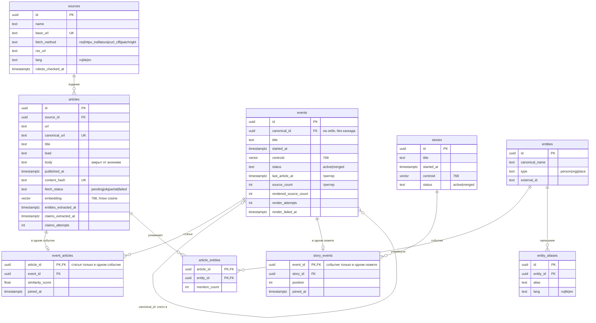
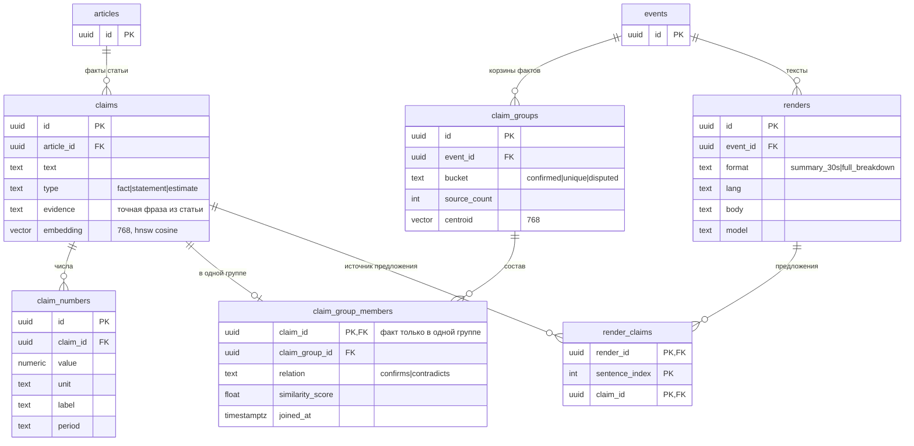
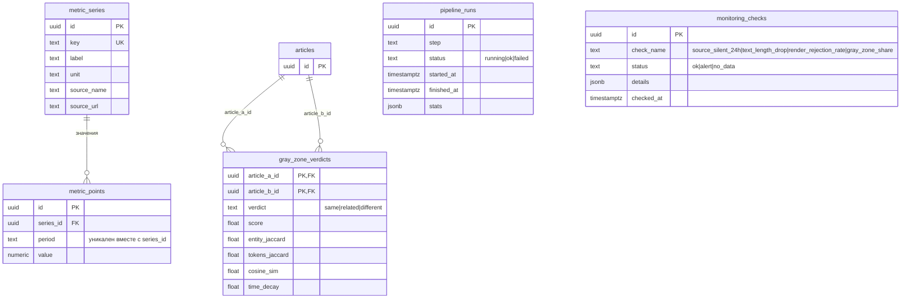

# ERD: схема базы данных

Состояние на 2026-11-18, снято с живой базы (каталог Postgres) и сверено с `supabase/migrations/`: в репо и в базе одни и те же
20 таблиц схемы `public`. Эталон схемы — миграции; этот файл их описывает, а не заменяет. Черновик в `CLAUDE.MD` §4 устарел
(см. «Отличия от черновика»).

Диаграммы Mermaid: GitHub рисует их сам. В VS Code нужен плагин Mermaid. Чтобы диаграммы не были нечитаемыми, схема разбита на три
части; таблицы, которые встречаются в нескольких частях, повторяются. Колонки `created_at` и `updated_at` на диаграммах опущены
(у каких таблиц они есть, написано под таблицей «Таблицы»). Все `id` — `uuid`, генерируются базой.

## 1. Сбор, сущности, события и сюжеты

## 2. Факты и тексты событий

`renders` уникальна по `(event_id, format, lang)`. `render_claims` связывает каждое предложение текста с фактом: на ней держится правило
«каждое предложение имеет источник» (§3.4 спецификации).

## 3. Метрики и служебные таблицы воркера

`pipeline_runs` и `monitoring_checks` ни с чем не связаны внешними ключами: это журналы воркера.

## Таблицы

Объём — оценка планировщика (`reltuples`) на 2026-11-18, не точный подсчёт.

| Таблица | Назначение | Объём | Что важно |
|---|---|---|---|
| `sources` | Издания и способ их сбора | ~10 | Уникален `base_url`. Список ведётся в `worker/.../sources.yaml` |
| `articles` | Собранные статьи | ~11,4 тыс. | Дедупликация по `canonical_url` и `content_hash` (оба уникальны). `body` — чужой полный текст, закрыт от анонима |
| `entities`, `entity_aliases`, `article_entities` | Нормализованные сущности, их написания, упоминания | ~43 тыс., ~47 тыс., ~110 тыс. | Уникальна пара `(canonical_name, type)`. Таблица алиасов вместе с приведением к именительному падежу даёт «Нацбанк = НБ РК» |
| `events` | Событие: одна новость, о которой написали несколько изданий | ~8,3 тыс. | `canonical_id` ведёт на событие, в которое слили это. Счётчики `source_count`, `last_article_at` пересчитывает триггер |
| `event_articles` | Какая статья в каком событии | ~8,1 тыс. | PK = `article_id`: статья входит ровно в одно событие |
| `stories`, `story_events` | Сюжет и порядок событий в нём | ~4,8 тыс., ~5,0 тыс. | PK `story_events` = `event_id`: событие входит ровно в один сюжет |
| `claims`, `claim_numbers` | Факты из статей с `evidence` и числа из них | ~12 тыс., ~9,9 тыс. | `evidence` обязателен (`NOT NULL`); отбрасывание факта, чья цитата не найдена в тексте, делает код воркера (§3.2 спецификации) |
| `claim_groups`, `claim_group_members` | Схлопнутые факты события в три корзины | ~1,3 тыс., ~2,5 тыс. | PK `claim_group_members` = `claim_id`: факт в одной группе |
| `renders`, `render_claims` | Тексты событий и связь предложений с фактами | ~170, ~790 | Один текст на `(событие, формат, язык)` |
| `metric_series`, `metric_points` | Исторические ряды (World Bank) | ~65 точек | Уникальна пара `(series_id, period)` |
| `gray_zone_verdicts` | Кеш ответов LLM по спорным парам статей и сигналы скоринга | ~9,9 тыс. | Не публичная, читает только воркер и `admin_reader` |
| `pipeline_runs` | Журнал запусков шагов конвейера | ~230 | Не публичная |
| `monitoring_checks` | Результаты проверок мониторинга (§6) | ~370 | Не публичная |

`created_at` есть у `sources`, `articles`, `entities`, `entity_aliases`, `events`, `stories`, `claims`, `claim_groups`, `renders`,
`metric_series`, `gray_zone_verdicts`. `updated_at` есть у `sources`, `articles`, `entities`, `events`, `stories`, `claim_groups`,
`renders`, `metric_series`. У таблиц-связок время вступления называется `joined_at`, у журналов — `started_at` и `checked_at`.

## Правила целостности

- **Каскадное удаление** (`ON DELETE CASCADE`): статья тянет за собой свои факты, упоминания, членство в событии и вердикты серой зоны;
  событие тянет группы фактов, тексты, привязку к сюжету; факт тянет числа, членство в группе и ссылки из текстов.
- **`articles.source_id` → `sources` — `RESTRICT`:** источник с статьями удалить нельзя.
- **`events.canonical_id` → `events` — без каскада:** событие, на которое кто-то указывает как на цель слияния, удалить нельзя, пока
  не удалены слитые на него. Это учтено в `hotaru-rebuild`.
- **Значения перечислений** — это `CHECK`-ограничения на `text`, а не типы `enum`: добавить значение можно миграцией, меняющей `CHECK`.

## Индексы, векторы, триггеры

- Все векторы — `vector(768)` (расширение `pgvector`). HNSW с косинусной метрикой построен на `articles.embedding` и `claims.embedding`.
  Индекс по `claims` по плану P0 (фаза 8) не используется кодом, его предлагалось удалить.
- Остальные индексы: внешние ключи, `articles (source_id, published_at desc)`, `articles (fetch_status)`, частичный
  `events (last_article_at desc) where status = 'active'` (очередь синтеза), `pipeline_runs (step, started_at desc)`,
  `monitoring_checks (check_name, checked_at desc)`.
- Триггер `set_updated_at` обновляет `updated_at` у `sources`, `articles`, `entities`, `events`, `claim_groups`, `renders`, `metric_series`.
- Триггер `event_articles_refresh_stats` при добавлении, удалении статьи или смене её события пересчитывает у затронутых событий
  `source_count` (число **различных изданий**, а не статей) и `last_article_at` (максимум `published_at` статей). Если у уже
  привязанной статьи позже изменится `published_at`, триггер не сработает.

## Отличия от черновика в `CLAUDE.MD` §4

| Черновик | Факт |
|---|---|
| `event_links` (связи между событиями с `evidence`) | **Нет таблицы** и нет ссылок на неё в коде. Это недостающая часть Этапа 4 («связи с типами и evidence») |
| `stories.slug` | Нет колонки |
| `renders.event_id \| story_id` | Только `event_id`: текстов уровня сюжета нет |
| не было | `claim_groups`, `claim_group_members` (три корзины фактов), `gray_zone_verdicts`, `monitoring_checks`, `pipeline_runs` |
| не было | У `events`: `last_article_at`, `source_count`, `rendered_source_count`, `render_attempts`, `render_failed_at` |
| не было | У `articles`: `entities_extracted_at`, `claims_extracted_at`, `claims_attempts`, `updated_at` |

## Миграции: расхождение истории

Таблица истории миграций в самой БД не совпадает с файлами в `supabase/migrations/` (их 19). Схема при этом полная, расхождение
только в учёте:

- **Нет в истории БД:** `entities`, `article_embeddings`, `events`, `claim_groups`, `monitoring_checks`, `renders`, `metrics`, `stories`,
  `admin_reader_role`: применены в обход учёта, результат в базе есть.
- **Версия в БД и в имени файла разная:** `restrict_public_columns` (в БД 20261111191011, файл 20261112090000), `pipeline_runs`
  (20261112113528 и 20261112120000), `fix_article_published_at` (20261115165936 и 20261115100000), `gray_zone_signals`
  (20261115183901 и 20261115120000), `event_stats_and_queues` (20261115190535 и 20261116100000). Одинаковы: `init_sources_articles`,
  `fix_function_search_path`, `claims` и две миграции прав от 2026-11-18.
- **Нет в репо:** запись `create_study_items` (20261015163500); такой таблицы в базе нет.

Следствие: `supabase db push` на этой базе, скорее всего, попытается применить уже применённые файлы и упадёт (я этого не запускал).
Для новой базы порядок по именам файлов рабочий, но на чистой базе я его не прогонял. Если понадобится `db push`, сначала выровняйте
историю командой `supabase migration repair`.
